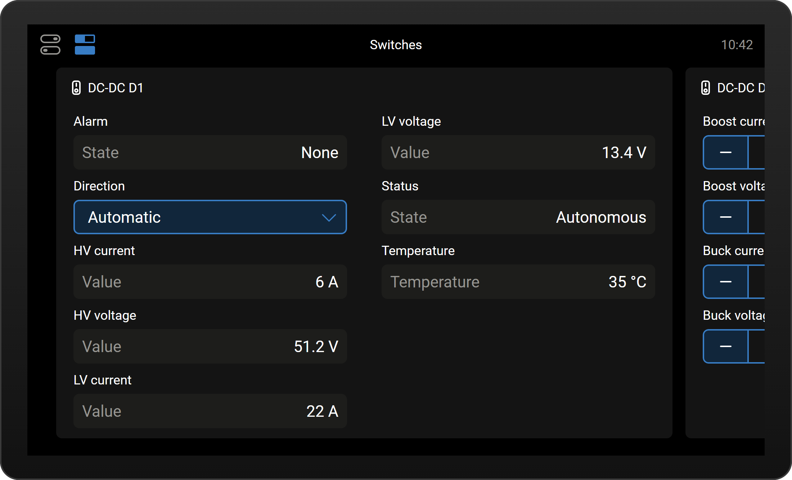
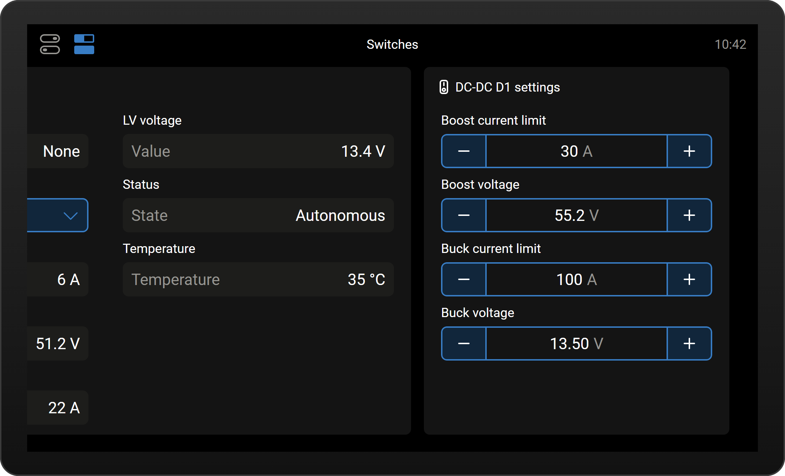
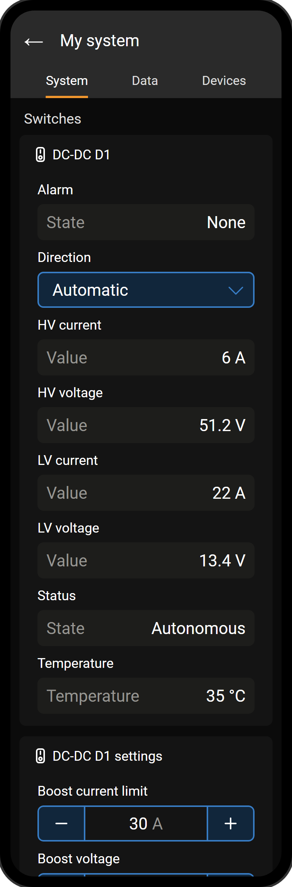
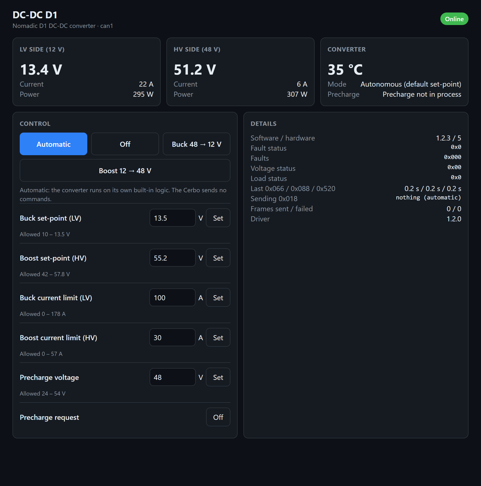
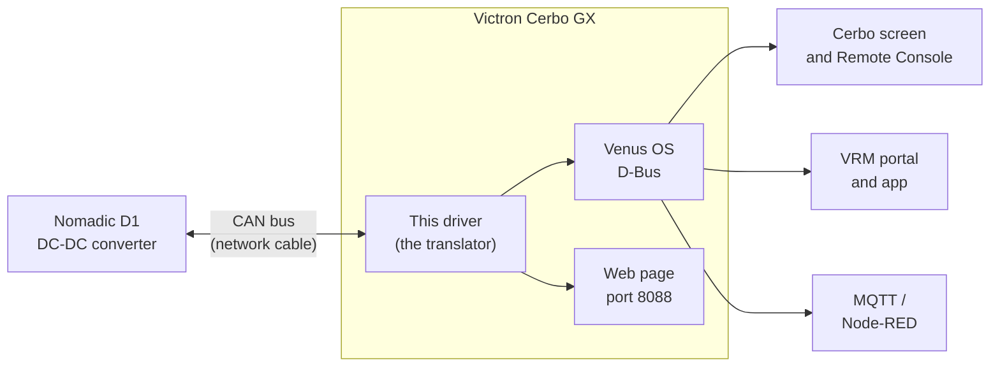

# cerbo-nomadic-d1

[](https://github.com/CKOCI13/cerbo-nomadic-d1/actions/workflows/tests.yml)
[](LICENSE)

**See and control a Nomadic D1 DC-DC converter from a Victron Cerbo GX.** Its readings and controls
then appear on the Cerbo's screen, in the VRM app on your phone, and on a small web page.


<sub>What the Cerbo screen shows. The picture is drawn from Victron's own screen design; the real screen may differ slightly.</sub>

> [!WARNING]
> **This controls power electronics.** It has been thoroughly tested in software (unit tests, a simulated
> converter, and checks against Victron's GUI source code), but **not yet on a real D1 and Cerbo**. Follow the
> [Safe Test Plan](docs/safe-test-plan.pdf) and use it at your own risk. This project isn't made by, or
> affiliated with, Victron Energy or Nomadic.

> [!TIP]
> **Two editions. This is the control edition, for advanced users.** If you only want to *see* what the D1 is
> doing, use the **[monitor-only edition (cerbo-nomadic-d1-monitor)](https://github.com/CKOCI13/cerbo-nomadic-d1-monitor)** instead. It shows the same readings on the Cerbo
> screen, in VRM and on a web page with charts, but it never sends the D1 anything. Choose this control edition only
> if you need the Cerbo to command the D1, for example to [limit its current](#limiting-current-to-protect-fuses-and-wiring),
> and you're ready to test it carefully. Only one of the two can be installed on a Cerbo at a time.

---

## Contents

- [What is this?](#what-is-this)
- [What it can do](#what-it-can-do)
- [What you need](#what-you-need)
- [Try it on your PC in one minute](#try-it-on-your-pc-in-one-minute)
- [Installing it for real](#installing-it-for-real)
- [Safety](#safety)
- [Limiting current to protect fuses and wiring](#limiting-current-to-protect-fuses-and-wiring)
- [Project status and open questions](#project-status-and-open-questions)
- [How it works](#how-it-works)
- [What's in this repository](#whats-in-this-repository)
- [For developers](#for-developers)
- [FAQ](#faq)
- [Glossary](#glossary)
- [License and credits](#license-and-credits)

---

## What is this?

Many vans, boats and off-grid systems have **two battery systems**: a big **48 V** battery for the heavy loads,
and **12 V** batteries for the vehicle itself. A **DC-DC converter** moves energy between them.

- The **Nomadic D1** is a bidirectional DC-DC converter. It can charge the 12 V side
  from the 48 V side (**buck**), or push energy from the 12 V side up to the 48 V side (**boost**). It decides
  this by itself, based on the 12 V battery's voltage. It also has a **CAN bus** connection for monitoring and control.
- The **[Victron](https://www.victronenergy.com) Cerbo GX** is the "brain and screen" of a Victron power system.
  It shows every battery, charger and inverter, and sends everything to Victron's **VRM** website and app.

The Cerbo doesn't know how to talk to the D1. **This project is the translator:** a small program (a "driver")
that runs on the Cerbo, speaks the D1's CAN language, and shows the D1 like any other Victron device.

New to all this? **[How it works, in plain English](docs/how-it-works.md)** explains it with pictures.

## What it can do

- **Show the D1's readings:** 12 V and 48 V voltage and current, temperature, what mode it's in, and every
  alarm and fault it reports, in plain words.
- **Run it automatically, within your limits.** **Automatic** is the default. The Cerbo makes the same buck, boost
  or standby choice the D1 would make by itself. It also sends your **current limits**, so the 12 V cable and fuse
  are never overloaded. Owners never need to choose Buck or Boost. You can still choose **Off**, **Buck** or
  **Boost** by hand, with your own voltage targets and current limits.
- **Work everywhere Victron does:** the Cerbo's touchscreen, Remote Console, the VRM portal and app, MQTT and Node-RED.
- **Offer its own web page** at `http://<cerbo-address>:8088`, for any phone or laptop on the same network.
- **Stay within your limits:** you set the highest and lowest values allowed, and anything outside them is refused.
- **Help you test safely:** a pretend converter for trying it out, a "find the converter" check, and a test timer.

| Cerbo: readings and controls | Cerbo: settings | VRM app |
|---|---|---|
|  |  |  |

## What you need

| | |
|---|---|
| **Converter** | A Nomadic D1 bidirectional DC-DC converter |
| **Victron device** | A Cerbo GX (or another Victron GX device) running **Venus OS v3.80 or newer** |
| **Cable** | A normal network (Ethernet) patch cable, which you adapt. The [Installation Guide](docs/installation-guide.pdf) shows how |
| **Terminators** | A 120 Ω resistor at the D1 end, plus the Victron terminator plug that comes with the Cerbo |
| **Connectors** | Two 3-way lever wire connectors (for example WAGO 221-413) |
| **A computer** | Windows, for the [`Cerbo Setup.bat`](Cerbo%20Setup.bat) helper. On Mac or Linux, use the commands in the [driver reference](dbus-nomadic-dcdc/README.md) |

You don't need to install anything on the Cerbo yourself, and you don't need programming knowledge:
the helper copies and installs the driver for you.

## Try it on your PC in one minute

You can see the driver working without a Cerbo or a converter. It includes a **pretend D1**.
You need [Python 3](https://www.python.org/downloads/) installed.

```bash
git clone https://github.com/CKOCI13/cerbo-nomadic-d1.git
cd cerbo-nomadic-d1
python dbus-nomadic-dcdc/dbus-nomadic-dcdc.py --simulate --no-dbus
```

Then open **<http://localhost:8089>** in your browser. Click **Buck** and watch the pretend 12 V battery charge
to 13.5 V, or leave it on **Automatic** and watch the pretend D1 decide by itself. Press **Ctrl+C** to stop.
(No Git? Click the green **Code** button on GitHub, then **Download ZIP**, unzip it, and run the last line
inside the unzipped folder. On Mac or Linux, type `python3` instead of `python`.)



## Installing it for real

Follow the **[Installation Guide (PDF)](docs/installation-guide.pdf)**. It has pictures for every step. In short:

1. **Make the cable.** Cut one end off a network cable and join its brown pair to the D1's labelled CAN_H and
   CAN_L wires with two lever wire connectors, with a 120 Ω resistor between them. No ground wire.
2. **Set up the Cerbo.** Check the firmware version, choose the CAN port and its speed, and allow your PC to connect.
3. **Connect everything.**
4. **Run [`Cerbo Setup.bat`](Cerbo%20Setup.bat)** on your Windows PC. It finds the converter, lets you edit the
   settings, and installs the driver with a menu: no commands to type. No network connection to the Cerbo?
   See [Installing from a USB stick](#installing-from-a-usb-stick-or-sd-card-no-network-needed) below.
5. **Test it** with the **[Safe Test Plan (PDF)](docs/safe-test-plan.pdf)**, one small step at a time.

After installing, the driver starts by itself whenever the Cerbo starts, including after firmware updates.

### Installing from a USB stick or SD card (no network needed)

Venus OS has a built-in way to install add-ons from a USB stick or microSD card. At start-up, it looks for a
`venus-data` file. It unpacks the file into the Cerbo's `/data` folder and runs the install script inside it
([Victron's `update-data.sh`](https://github.com/victronenergy/meta-victronenergy/blob/master/meta-venus/recipes-core/initscripts/files/update-data.sh)).
This project's hook installs the driver as a service, so you don't need SSH, a root password or the Superuser
access level.

1. **Get the file.** Download **`venus-data-nomadic-d1.tar.gz`** from the [latest release](https://github.com/CKOCI13/cerbo-nomadic-d1/releases/latest). It has the standard settings,
   including `interface = auto`, so the driver finds the D1's CAN port by itself on any Cerbo.
   (On a Mac, download with Chrome or Firefox: Safari can unpack it into a `.tar` file, which the Cerbo ignores.)
2. **Copy it** to the top folder of a USB stick or SD card (FAT32 is the safe choice), not inside another folder.
   Put only **one** `venus-data` file on the stick, and check its name: if your browser saved it as
   `venus-data-nomadic-d1 (1).tar.gz`, rename it back to `venus-data-nomadic-d1.tar.gz`. The Cerbo skips names with spaces.
3. **Check one setting:** *Settings › General › Modification checks*: modifications must be enabled (the default).
   When they're off, Venus OS switches off the start-up script and the driver disappears after a restart.
4. **Put the stick in the Cerbo and restart it** (Settings › General › Reboot, or switch it off and on).
5. **Wait about 2 minutes, then take the stick out.** The Cerbo renames the file on the stick to
   `...tar.gz.installed`, so it never installs twice, even if you leave the stick in.
6. Open the **switch pane** on the Cerbo screen: the DC-DC D1 cards should be there.

**Want different settings?** Edit [`dbus-nomadic-dcdc/config.ini`](dbus-nomadic-dcdc/config.ini), then make your
own file: on Windows run `Cerbo Setup.bat` and choose **U** (just press Enter when it asks for the Cerbo's IP
address); on Mac or Linux run `sh make-usb-installer.sh`. Then follow steps 2 to 6. The stick's `config.ini`
replaces the one on the Cerbo.

If the Status card says **No communication**, check the D1's power, the cable and terminators, and the CAN port's
profile and speed (250 / 500 kbit/s) as the Installation Guide describes. To remove the driver you still need SSH
(`sh /data/dbus-nomadic-dcdc/uninstall.sh`) or Cerbo Setup option 8.

## Safety

The driver is careful by design:

- **It starts in Automatic with limits.** It uses the D1 manual's own switch points: buck below 12.5 V, and
  boost from 13.5 V until the 12 V side drops to 12.3 V. It waits 2 seconds before each change, so a dip while
  the engine cranks is ignored. After the 12 V side sags, it waits a minute before boosting again. It only asks
  for one direction at a time, with Off in between.
- **Hands-off option.** Set `automatic = hands_off` to make Automatic send nothing at all. The D1 then runs on its
  own logic and factory limits, exactly as without a Cerbo.
- **Every value is checked against limits** that you set in [`config.ini`](dbus-nomadic-dcdc/config.ini).
  The voltage limits are the D1 manual's own ranges: 10–13.5 V for buck and 42–57.8 V for boost. The current
  limits suit a stock Grand Design LTV1, which has 2 AWG cable on a 150 A fuse. They are 120 A for buck and 23 A
  for boost. Either way, that keeps the 12 V cable under 120 A.
- **Changing between buck and boost** always passes through Off for a second.
- **A test timer** (optional) switches Buck or Boost back to Off after a few minutes.
- **The D1 protects itself** against over-voltage, over-current, short circuits and overheating.
- **The D1's wake-up wire (KL15) is the emergency stop:** switched off, the D1 stops straight away, whatever the Cerbo says.
  If KL15 is joined to KL30 on one always-on 12 V wire (as on the LTV1), there's no switch: pull that wire's fuse,
  or open the D1's power fuses or breaker.

Before relying on Off, Buck or Boost, do the **"hand-back" test** in the Safe Test Plan (see the next section for why).

## Limiting current to protect fuses and wiring

Left to itself, the D1 can push up to **178 A into the 12 V side** (buck) and **57 A into the 48 V side** (boost),
per its manual. If a fuse or cable on either side is smaller than that, the fuse can blow, or the cable can overheat.
This edition can hold the D1 to a lower current:

1. In [`config.ini`](dbus-nomadic-dcdc/config.ini), set `buck_current_limit_max` (and `boost_current_limit_max` if
   you use boost) to what your fuse and cable can take with a margin. For example, about 80 % of the fuse rating,
   and never more than the cable's rating. Nobody can then set a higher value, from the screen, VRM or the web page.
   **For boost, convert first** (see below): its limit is in 48 V-side amps.
2. Set `buck_current_limit` and `boost_current_limit` to the currents you want (at most the `_max` values).
3. Leave the Cerbo on **Automatic** (`automatic = limited`, the default). It then chooses buck, boost or standby by
   itself and always sends these limits, also after every restart.

**The boost limit is counted on the 48 V side.** `buck_current_limit` is the current on the 12 V side, but
`boost_current_limit` is the current the D1 delivers on the **48 V** side. Boosting, it draws about four to five
times as many amps from the 12 V side, and that is the side with the long cable and the breaker in most vans:

> 12 V-side amps ≈ `boost_current_limit` × 48 V-side volts ÷ (12 V-side volts × 0.92 efficiency)

The worst case is a full 48 V battery (58 V) with the 12 V side sagging to 12.3 V, where boost stops:

| `boost_current_limit` (48 V side) | 12 V-side current, typical (55 V, 13.4 V) | Worst case (58 V, 12.3 V) |
|---|---|---|
| 15 A | about 67 A | about 77 A |
| 20 A (the default) | about 89 A | about 103 A |
| 23 A (the default maximum) | about 103 A | about 118 A |
| 30 A | about 134 A | about 154 A |
| No limit (Automatic, factory setting) | up to about 200 A (2.5 kW) | about 220 A |

**Example:** a 12 V cable protected by a **150 A breaker**, kept at 80 % = 120 A, gives
`boost_current_limit_max = 23` (120 × 12.3 × 0.92 ÷ 58). Measure with a clamp meter on the 12 V cable during the
Safe Test Plan's boost step to confirm, because efficiency drops at high power and the real current can be higher.

**Stock Grand Design LTV1.** The shipped `config.ini` is already set for its 2 AWG cable and 150 A fuse:
`buck_current_limit_max = 120` and `boost_current_limit_max = 23`. Nobody can choose more. Left on its own, the
D1 can draw well over 150 A from the 12 V side: up to about 200 A when boosting, and 178 A when bucking. That's
more than the cable and fuse are meant for. In **Automatic** (with limits, the default), and in Buck or Boost, the Cerbo holds it to
these limits. Only with `automatic = hands_off` does Automatic send nothing and leave the D1 at its factory limits.
If you've upgraded the cable and fuse, raise the two `_max` values to match (80 % of the new fuse, converted for
boost as above).

**How Automatic with limits works.** The Cerbo reads the D1's 12 V and 48 V voltages 100 times a second. Then it
makes the same choice the D1 would make:

- **Buck** when the 12 V side is below 12.5 V (and the 48 V side is 41–58 V). It charges the 12 V side to about 13.4 V.
- **Standby** between 12.5 and 13.5 V.
- **Boost** from 13.5 V, until the 12 V side falls below 12.3 V.

It waits 2 seconds before each change. After boost stops because the 12 V side sagged, it waits a minute before
trying again, so a weak alternator can't make it flip back and forth. If the D1's readings stop, it sends Off.
**Choosing Buck or Boost by hand** overrides all this until you choose Automatic again.

> [!CAUTION]
> **This is not a replacement for correctly sized fuses and cables.** The limit only holds while the Cerbo keeps
> sending its command every 10 ms. The commands stop while the Cerbo restarts or updates its
> firmware, if the driver stops, or if the CAN cable comes loose. Nobody knows yet what the D1 does then. It may go back
> to its own logic **at full current**. So:
>
> - **Never fit a bigger fuse than the cable is rated for** to stop it blowing. The fuse is what protects the cable.
> - The lasting fix is a cable and fuse sized for the D1's maximum currents, or asking **Nomadic** to lower the D1's
>   own current limit, which then holds with or without a Cerbo.
> - Use the Cerbo's limit as an extra layer on top of that, and only after the **hand-back test** (Safe Test Plan,
>   step 5g) has shown what your D1 does when the commands stop.

## Project status and open questions

**Works and is tested in software:**

- The CAN encoding and decoding, checked against frames worked out by hand from Nomadic's specification.
- The control logic, limits, test timer and settings that survive a restart.
- The Cerbo screen and VRM items, checked against the rules in Victron's GUI source code.
- The web page and its API, the "find the converter" scan, and the pretend D1.

Every change is tested automatically by GitHub ([the tests badge](#cerbo-nomadic-d1) above).

**Not yet tried on real hardware**, and **not yet known** (Nomadic's documents don't say):

1. When the Cerbo stops sending commands (a restart, or the cable comes loose), does the D1 go back to its own
   logic, and how quickly? The Safe Test Plan includes a test for this.
2. Does the D1 send its readings even when it isn't receiving commands? The driver assumes it does.
3. Which direction counts as positive current in the D1's readings.
4. Whether the 12 V target may go above 13.5 V. The D1 manual's adjustable range stops at 13.5 V.

If you try it, please share what you find in an [issue](../../issues).

## How it works



- **Listening:** the D1 sends three kinds of CAN message: measurements 100 times a second, status 20 times a
  second, and its version 10 times a second. The driver decodes them and publishes them on Venus OS's internal
  message bus (D-Bus). Everything else in the Cerbo (the screen, VRM, MQTT) reads them from there.
- **Controlling:** the driver sends one control message every 10 ms (what the D1's specification requires), with
  the direction, voltage target and current limit. In Automatic it picks the direction itself from the D1's
  readings; when you choose Off, Buck or Boost, it sends that. (With `automatic = hands_off`, Automatic sends nothing.)
- **On the screen:** the driver uses Victron's standard "switch" interface, the same one GX relays and smart
  switches use. So its readings and controls appear in the Cerbo's switch pane and in VRM, without changing any
  Victron software.

The **[developer guide](docs/developer-guide.md)** explains the design in detail.

## What's in this repository

```
cerbo-nomadic-d1/
├── README.md                 ← you are here
├── Cerbo Setup.bat           ← Windows helper: copies, tests and installs the driver on the Cerbo
├── make-usb-installer.sh     ← Mac/Linux: makes venus-data-nomadic-d1.tar.gz for a USB-stick install
├── usb/rc/post-hook.sh       ← run by the Cerbo after a USB-stick install: installs the service
├── dbus-nomadic-dcdc/        ← the driver itself: this whole folder goes onto the Cerbo
│   ├── dbus-nomadic-dcdc.py      the driver program
│   ├── nomadic_can.py            encodes and decodes the D1's CAN messages
│   ├── config.ini                settings and safety limits (edit this)
│   ├── webui.html                the built-in web page
│   ├── install.sh, uninstall.sh  add / remove it as a Cerbo service
│   ├── service/                  start-up scripts used by Venus OS
│   └── README.md                 technical reference: every setting, D-Bus path and command
├── docs/
│   ├── installation-guide.pdf    step-by-step guide with pictures
│   ├── safe-test-plan.pdf        printable checklist for testing it safely
│   ├── how-it-works.md           plain-English explanation with pictures
│   ├── developer-guide.md        how the code is built
│   ├── images/                   pictures used by the docs
│   └── src/                      source of the Installation Guide PDF, and the script that builds it
├── tests/                    ← automated tests (run on any PC)
├── .github/workflows/        ← makes GitHub run the tests on every change
├── CHANGELOG.md              ← what changed in each version
└── LICENSE                   ← MIT No Attribution: use it for anything
```

## For developers

- The driver is plain **Python 3** using only the standard library, plus the libraries already on every
  Victron GX device (`dbus-python`, `PyGObject` and Victron's `velib_python`).
- Run the tests on any computer: `python -m unittest discover -s tests -v`. See [tests/README.md](tests/README.md).
- The **[developer guide](docs/developer-guide.md)** covers the architecture, threads, CAN messages, control
  logic, D-Bus mapping, web API, simulation and how to make changes safely.
- The **[driver reference](dbus-nomadic-dcdc/README.md)** lists every setting, D-Bus path and manual command.

Contributions are welcome: open an issue or a pull request.

## FAQ

**Will installing this change how my D1 behaves?**
It makes the same buck, boost and standby choices as before, but within your current limits. To install it
without changing anything at all, so it only watches, set `automatic = hands_off` first. The
[Safe Test Plan](docs/safe-test-plan.pdf) does this for its first stages.

**Do I have to choose Buck or Boost?**
No. Leave it on Automatic. It switches by itself, exactly when the D1 would, and keeps to your limits.

**Do I need to know how to program?**
No. The [Installation Guide](docs/installation-guide.pdf) and the `Cerbo Setup.bat` menu cover everything.
You will make a simple cable and press some buttons on the Cerbo's screen.

**Does it work with Victron's VRM app?**
Yes. The readings and controls appear in the **Switches** section of the VRM portal and app. To change values
remotely, set *Settings → VRM → VRM Portal access level* to **Full** on the Cerbo.

**Can I break something?**
The D1 protects itself, and the driver refuses values outside your limits. A wiring mistake is the biggest
real risk: the Safe Test Plan checks the wiring with the power off before anything is switched on.

**How do I remove it?**
Run `Cerbo Setup.bat` and choose **8**. The D1 carries on working on its own.

**Where are Nomadic's documents?**
They're Nomadic's copyrighted material, so they aren't included here. Ask Nomadic for the *D1 Bidirectional
DC-DC Converter Manual* and the *DC-DC Converter CAN Interface Control Document* (NI-TLN-CONTROLS-DCDCCAN-R1).

## Glossary

| Term | Meaning |
|---|---|
| **Buck** | Converting down: the 48 V side charges the 12 V side |
| **Boost** | Converting up: the 12 V side pushes energy to the 48 V side |
| **CAN bus** | A two-wire network that vehicles and batteries use to exchange short messages |
| **CAN-H / CAN-L** | The two CAN wires ("high" and "low"), twisted together |
| **Termination** | A 120 Ω resistor at each end of a CAN bus, which stops messages reflecting back |
| **Lever connector** | A small clear wire joiner with orange levers (for example WAGO 221). Lift a lever, push in a stripped wire, close the lever |
| **Current limit** | The most amps the Cerbo lets the converter use. Buck is counted on the 12 V side, boost on the 48 V side |
| **Automatic with limits** | The default mode: the Cerbo makes the converter's own buck / boost / standby choice and sends the current limits with it |
| **KL30 / KL15** | Automotive names for the D1's permanent 12 V supply (KL30) and its "wake-up" / enable input (KL15) |
| **Cerbo GX / GX device** | Victron's system monitor and controller |
| **Venus OS** | The Linux-based software that runs on Victron GX devices |
| **D-Bus** | The internal message system Venus OS uses to share values between programs |
| **VRM** | Victron Remote Management: Victron's website and phone app for remote monitoring |
| **Remote Console** | The Cerbo's screen, shown in a web browser or in VRM |
| **Switch pane** | The page on the Cerbo screen that shows switches, sliders and readings from devices |
| **Driver** | A program that lets one device (the Cerbo) understand another (the D1) |

## License and credits

- **License:** [MIT No Attribution (MIT-0)](LICENSE). You may use, copy, change and share this for any purpose,
  with no need to credit anyone. It comes with **no warranty**.
- **Trademarks:** Victron Energy, Cerbo GX, Venus OS and VRM are trademarks of Victron Energy B.V. Nomadic and
  D1 belong to their owner. This project isn't affiliated with or endorsed by either company.
- **Built on:** Victron's open-source [Venus OS D-Bus API](https://github.com/victronenergy/venus/wiki/dbus),
  [velib_python](https://github.com/victronenergy/velib_python) and the [gui-v2](https://github.com/victronenergy/gui-v2)
  design, and Victron's [VE.Can cable pinout](https://www.victronenergy.com/live/battery_compatibility:can-bus_bms-cable).
