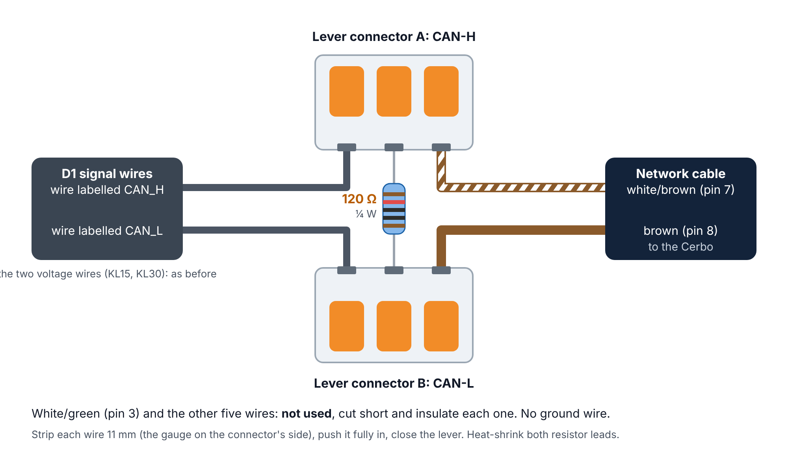

# Nomadic D1 DC-DC converter: driver for a Victron Cerbo GX

This driver runs on a Victron GX device (Cerbo GX, Ekrano GX or another device running Venus OS). It implements
the CAN interface in `NI-TLN-CONTROLS-DCDCCAN-R1` (EMS_DCDC_CTRL 0x018, DCDC_PARAMETER 0x066,
DCDC_ELECTRIC_VALUE 0x088, DCDC_VERSION 0x520). With it you can:

* **Check the parameters.** LV/HV voltage and current, temperature, operating mode, precharge status, firmware
  and hardware version, and every fault, voltage, load and derating bit, decoded into plain text.
* **Automatic with limits, or your own choice.** By default (**Automatic**, `automatic = limited`) the driver picks
  buck, boost or standby itself, by the D1 manual's own rules, from the D1's readings. Choosing **Off**, **Buck**
  (48 → 12 V) or **Boost** (12 → 48 V) overrides that. Either way it sends EMS_DCDC_CTRL every 10 ms (as the CAN
  spec requires) with the direction, the voltage set-point and current limit for that side, and the precharge
  request. With `automatic = hands_off`, Automatic sends nothing and the D1 runs on its own built-in logic.

You can work with it from:

* the **GX screen / Remote Console**: readings and controls in the switch pane and on the device page
* **VRM**: the Switches panel on the VRM dashboard, and the Switches widget in the VRM app
* a **web page** at `http://<GX-IP>:8088`
* **D-Bus, MQTT and Node-RED**, where every value and control is a path (listed below)

> This is the **technical reference** for the driver folder. New here? Start with the
> [project README](../README.md). For step-by-step instructions with pictures, see the
> [Installation Guide](../docs/installation-guide.pdf). The [`Cerbo Setup.bat`](../Cerbo%20Setup.bat) helper in the
> project folder does all of the steps below from Windows, with no typing of commands.

## 1. Wiring

| D1 wire (labelled, from its signal plug) | Connect to |
|---|---|
| CAN_H | GX RJ45 **pin 7** (white/brown), in lever connector A with one resistor leg |
| CAN_L | GX RJ45 **pin 8** (brown), in lever connector B with the other resistor leg |
| KL15 (enable) | 12 V enable, ≥ 8 V = on: switched (ignition, relay) or linked to KL30 |
| KL30 | Permanent **fused** 12 V (9–16 V, up to 2 A) |
| (no CAN ground) | RJ45 pin 3 (white/green) is not used |



* **The D1 needs KL30 and KL15** (manual Rev D). Without them its controller is off, and it neither converts
  nor talks on CAN.
* **No CAN ground wire.** CAN is differential, and the GX and the D1 already share the system negative through
  their power wiring. The GX's VE.Can 2 port is not isolated, so a thin CAN-ground wire would run in parallel with
  the main negative cables. Leave RJ45 pin 3 unconnected. Check once with the D1 working hard: Cerbo negative to
  D1 GND should be a few tenths of a volt; over about 1 V means a poor negative connection.
* **Joining:** two 3-way lever connectors (e.g. WAGO 221-413, 24–12 AWG; strip 11 mm). A: D1 CAN_H + white/brown +
  resistor leg. B: D1 CAN_L + brown + other resistor leg. Insulate the resistor legs.
* Victron RJ45 pinout: **pin 7 CAN-H, pin 8 CAN-L** (Victron's VE.Can to CAN-bus BMS cable manual). Leave the
  other pins unconnected.
* The bus needs exactly **two 120 Ω terminators**: a VE.Can terminator in the GX port's second socket, and
  a **120 Ω resistor between CAN_H and CAN_L at the D1** (the D1 has no built-in terminator). With everything
  connected and off, CAN-H to CAN-L should measure about 60 Ω.
* Use a port that has nothing else on it, normally the Cerbo's **second CAN port** (usually `can1`; `--scan`,
  below, lists the real names and shows which one the converter is on):
  * **Cerbo GX MK2** (ports labeled VE.Can 1 and VE.Can 2): use **VE.Can 2**. It is not isolated: its CAN GND
    is the Cerbo's own negative, which is why no separate CAN ground wire is run.
  * **Original Cerbo GX** (second port labeled BMS-Can): BMS-Can only runs at **500 kbit/s** (see section 2).

## 2. Bitrate and port profile

The D1 talks at either 250 or 500 kbit/s, and the GX port must match it. On the GX, go to
**Settings → Connectivity → (your CAN port) → CAN-bus profile** and choose **"VE.Can (250 kbit/s)"** (the default).
If `--scan` reports bus errors but no frames, the D1 is at the other speed: switch to
**"CAN-bus BMS LV (500 kbit/s)"** (called "CAN-bus BMS (500 kbit/s)" on older firmware).

Victron's own services on the port use 29-bit (extended) CAN IDs; the D1 uses 11-bit (standard) IDs, and the
driver only listens for those, so they share the port without trouble.

**"Up, but no services"** (250 or 500 kbit/s) would bring the port up with no Victron services at all, but the
Cerbo screen (gui-v2, Venus OS v3.80+) hides it and won't let you choose it. If you want it anyway, set it over
SSH, using the port name from `--scan` (for example `vecan1` or `can1`); 5 = 250 kbit/s, 8 = 500 kbit/s:

```sh
dbus -y com.victronenergy.settings /Settings/Canbus/vecan1/Profile SetValue 5
```

On a Cerbo GX MK2 the second port's menu is **VE.Can port 2** (some firmware still calls it BMS-Can port).
On an **original Cerbo GX**, the BMS-Can port is fixed: its only choices are
**CAN-bus BMS (500 kbit/s)** and disabled. Leave it on CAN-bus BMS (500 kbit/s). It works only if the D1 talks
at 500 kbit/s; if `--scan` reports bus errors there, the D1 is at 250 kbit/s, so use the VE.Can port instead.

## 3. Root access

1. Go to **Settings → General → Access & Security → Access level** and choose **User & Installer**
   (password `ZZZ`).
2. Still on the Access & Security page, pull the list down and hold it for 5 seconds (on Remote Console with a
   keyboard: hold the right-arrow key). The access level changes to **Superuser**.
3. Set a **Root password** (8 characters or more) and switch on **Enable SSH on LAN**.

## 4. Copy the files

From PowerShell in the folder that contains `dbus-nomadic-dcdc`:

```
scp -O -r dbus-nomadic-dcdc root@<GX-IP>:/data/
```

(Leave out `-O` with OpenSSH older than 9.0.) Everything under `/data` survives firmware updates.

### Or: install from a USB stick or SD card

Download `venus-data-nomadic-d1.tar.gz` from the [latest release](https://github.com/CKOCI13/cerbo-nomadic-d1/releases/latest) (or edit `config.ini` and build your own with
`Cerbo Setup.bat` option U or `sh make-usb-installer.sh`), copy it to the top folder of a FAT32 USB stick or SD card,
put it in the GX and restart. Modifications must be enabled (*Settings › General › Modification checks*, the default).
Venus OS unpacks it into `/data` and runs its `rc/post-hook.sh`, which runs `install.sh`: steps 4 and 7 are done
for you, with no SSH. The hook then renames the file on the stick to `...tar.gz.installed`, so it installs only once. See the [project README](../README.md#installing-from-a-usb-stick-or-sd-card-no-network-needed).

## 5. Find the converter and check communication (listen-only, sends nothing)

```
ssh root@<GX-IP>
python3 /data/dbus-nomadic-dcdc/dbus-nomadic-dcdc.py --scan       # which port, its speed, bus errors, Venus OS version
python3 /data/dbus-nomadic-dcdc/dbus-nomadic-dcdc.py --monitor    # live readings; Ctrl+C to stop
```

`--monitor` should show about `0x066=20/s 0x088=100/s 0x520=10/s`. If nothing is heard, check the cable,
the termination and the bitrate (`ip -details link show can1`).

## 6. Configure

Edit `config.ini`. At minimum, set:

* `interface`: leave it on `auto` (the driver uses the CAN port it hears the D1 on), or force the port that
  `--scan` reported. Names differ between models: `can0`/`can1`, or `vecan0`/`vecan1` on the Cerbo GX MK2
* the **limits** (`buck_voltage_min/max`, `boost_voltage_min/max`, `buck_current_limit_max`,
  `boost_current_limit_max`): they default to the D1's own ranges. Tighten them to what your batteries,
  wiring and fuses can safely take. The driver rejects any command outside them.
* the values used when you choose Buck or Boost (`buck_voltage`, `boost_voltage`, `buck_current_limit`,
  `boost_current_limit`), especially `boost_voltage`, which should be your 48 V battery's charge voltage
* `startup`: `auto` (recommended) puts the Cerbo in Automatic after every restart
* `automatic`: `limited` (recommended) makes Automatic choose buck / boost / standby by the manual's rules and
  send your current limits; `hands_off` makes Automatic send nothing, so the D1 runs on its own logic

## 7. Install as a service

```
sh /data/dbus-nomadic-dcdc/install.sh
tail -F /var/log/dbus-nomadic-dcdc/current | tai64nlocal
```

The driver starts within a few seconds and restarts by itself if it ever stops. `install.sh` adds itself
to `/data/rc.local`, so the driver also comes back after reboots and firmware updates.

After you edit `config.ini`, restart the driver with `svc -t /service/dbus-nomadic-dcdc`.

## 8. Use it

### GX screen, Remote Console and VRM

This needs **Venus OS v3.80 or newer** on the GX (check under Settings → General → Firmware). The controls work from
v3.70, but the readings need v3.80. The driver publishes its readings and controls through Victron's
standard switch API, so they appear wherever Victron shows switches:

* **GX touchscreen and Remote Console** (including the Console tab in VRM): open the **switch pane**.
* **Settings → Devices → DC-DC D1**: the device page lists every item and lets you rename it, move it to another card,
  or hide it. Your changes are kept in `ui.json`.
* **VRM portal**: the **Switches** panel on the dashboard.
* **VRM app** (Android/iOS): the **Switches** widget.

Two cards appear. The precharge items start hidden, because the D1 manual doesn't use precharge. Show them
from the device page if you need them.

| Card | Item | Shows / does |
|---|---|---|
| **DC-DC D1** | Alarm | The most serious active alarm. The header turns red ("Fault") on a fault, and "N active" appears when there are several |
| | Direction | Dropdown: **Automatic** (the Cerbo decides, within your limits) / Off / Buck 48V to 12V / Boost 12V to 48V |
| | Status | The converter's operating mode, or "No communication" |
| | LV voltage, LV current, HV voltage, HV current | Live readings |
| | Temperature | Power board temperature, in your GX temperature unit (°F or °C, see below) |
| | Precharge status *(hidden)* | In progress / Not active |
| **DC-DC D1 settings** | Buck voltage | LV set-point used in buck (number box) |
| | Buck current limit | LV-side output current limit used in buck |
| | Boost voltage | HV set-point used in boost |
| | Boost current limit | HV-side output current limit used in boost |
| | Precharge request *(hidden)* | On/off toggle. Use it with Off, Buck or Boost |
| | Precharge voltage *(hidden)* | Precharge target |

The number boxes only go as far as the limits in `config.ini`. Those limits are deliberately left out of the
GX screen, so nobody can widen them from the screen or from VRM.

For **VRM**, the GX has to be online. To change values from VRM, set **Settings → VRM → VRM Portal access
level** to **Full**. If VRM shows the values but won't accept changes, check that setting first.

Set `switch_pane = no` in `config.ini` if you don't want any of this on the GX or in VRM.

### Web page

Open `http://<GX-IP>:8088`. It shows live values, alarms, the decoded status bits and the exact 0x018 frame
being sent, and it has buttons for Automatic / Off / Buck / Boost and inputs for each set-point. Set `password` in
`config.ini` to require a login. Without a password, **anyone on your network can operate the converter**.

**Fahrenheit or Celsius:** the Cerbo screen, VRM and the web page all show the temperature in the unit set on the Cerbo, at **Settings → General → Display & Appearance → Data units → Temperature**. Choose **Fahrenheit** there for °F. `temperature_unit` in the `[web]` part of `config.ini` can force the web page to `fahrenheit` or `celsius` instead; on a PC (`--simulate` or `--no-dbus`) the page shows °F.

### As a DC-DC converter in the device list

The driver also registers as a standard DC-DC converter named `custom_name` (default "DC-DC D1"). Output
(`Dc/0`) is always the **LV side** and input (`Dc/In`) is always the **HV side**, whichever direction it runs.
`/Mode` off = Off; on = back to the last choice (Automatic, Buck or Boost).

If the GX's "DC system" or "DC loads" figures look wrong after installing, it is because the GX counts this as
a DC-DC charger. In that case set `service_class = nomadicdcdc`. The converter drops out of the device list,
but the switch pane, VRM Switches, D-Bus, MQTT and the web page keep working.

### D-Bus / MQTT / Node-RED

Service: `com.victronenergy.dcdc.nomadic_<interface>` (`nomadic_auto` with the default `interface = auto`) (MQTT: `N/<portal-id>/dcdc/<device_instance>/...`)

| Path | Meaning |
|---|---|
| `/Dc/0/Voltage`, `/Dc/0/Current`, `/Dc/0/Power` | LV side (V, A, W) |
| `/Dc/In/V`, `/Dc/In/I`, `/Dc/In/P` | HV side (V, A, W) |
| `/Dc/0/Temperature` | Power board temperature (°C; the GX screen and VRM convert it to your unit) |
| `/State` | 0 off, 2 fault, 11 regulating, 245 starting |
| `/Mode` (writable) | 1 on, 4 off |
| `/Nomadic/Online` | 1 while frames are arriving |
| `/Nomadic/OperatingMode`, `/Nomadic/OperatingModeText` | Raw DCDC_OPERATING_MODE and its text |
| `/Nomadic/PrechargeStatus`, `/Nomadic/PrechargeStatusText` | Raw DCDC_PRECH_STATUS and its text |
| `/Nomadic/FaultStatus`, `/Nomadic/Faults`, `/Nomadic/VoltageStatus`, `/Nomadic/LoadStatus` | Raw bitfields |
| `/Nomadic/Alarms` | All active bits as text, `;`-separated |
| `/Nomadic/SoftwareVersion` | BCD software version, e.g. `1.2.3` |
| `/Nomadic/Control/Direction` (writable) | -1 automatic, 0 off, 1 buck, 2 boost |
| `/Nomadic/Control/BuckVoltage` (writable) | LV regulation set-point used in buck |
| `/Nomadic/Control/BoostVoltage` (writable) | HV regulation set-point used in boost |
| `/Nomadic/Control/BuckCurrentLimit` (writable) | DCDC_IMAX_REQ used in buck, A |
| `/Nomadic/Control/BoostCurrentLimit` (writable) | DCDC_IMAX_REQ used in boost, A |
| `/Nomadic/Control/Precharge` (writable) | 0/1, DCDC_PRECH_REQ |
| `/Nomadic/Control/PrechargeVoltage` (writable) | DCDC_UPRECH_REQ, 24..54 V |
| `/Nomadic/Control/SentDirection` | Direction actually in the frame: what Automatic chose, 0 during a reversal pause, empty when nothing is sent (`automatic = hands_off`) |
| `/Nomadic/Control/AutoReason` | In Automatic with limits: why it chose that direction, in words (empty otherwise) |
| `/GenericInput/<item>/...`, `/SwitchableOutput/<item>/...` | The switch pane items above ([Victron switch API](https://github.com/victronenergy/venus/wiki/dbus#switch)) |

From the GX shell: `dbus -y com.victronenergy.dcdc.nomadic_auto /Nomadic/Control/BuckVoltage SetValue 13.2`.
Over MQTT, publish `{"value": 13.2}` to `W/<portal-id>/dcdc/<device_instance>/Nomadic/Control/BuckVoltage`.

## Behaviour and safety

* After every start or reboot the driver is in **Automatic** (`startup = auto`). With `automatic = limited` (the
  default) it makes the D1 manual's own choice and sends it with your limits: buck below 12.5 V on the 12 V side
  (with the 48 V side at 41–58 V), to about 13.4 V (`buck_voltage`, capped at 13.4 V so buck doesn't cross its
  own 13.5 V exit threshold); standby from 12.5 to 13.5 V; boost from 13.5 to 16 V, until the 12 V side falls
  below 12.3 V. Each change needs its condition to hold for 2 s; after a low-voltage boost stop, boost waits 60 s;
  if the D1's readings stop, it sends Off. With `automatic = hands_off` it sends nothing and the D1 runs on its own
  logic at its factory limits. `startup = off` or `last` change the start-up choice. Set-points are remembered (in `state.json`). The precharge request always starts off.
* The default voltage limits are the D1 manual's adjustable ranges: buck target 10–13.5 V, boost target
  42–57.8 V. The default current limits suit a stock Grand Design LTV1 (2 AWG, 150 A fuse): buck 0–120 A,
  boost 0–23 A (48 V side, about 118 A on the 12 V side at worst). The D1 itself allows 178 A and 57 A; only
  raise them if your cable and fuses are sized for it.
* Every command, whatever it comes from, is checked against the limits in `config.ini` and rejected if it
  falls outside them.
* Changing between buck and boost always holds OFF for `direction_change_delay` seconds (1 s by default) first.
* Voltages are sent at the spec's 15 mV resolution, rounded to the nearest step. 13.5 V goes out as 13.500 V,
  and 55.2 V as 55.200 V.
* Unused bits in the 0x018 frame are sent as 0.
* **If the driver or the GX stops while it's in control, the 0x018 frames stop.** It isn't known whether the D1
  then goes back to its autonomous logic (the CAN spec lists a "CAN Loss" fault and an "Autonomous mode") or holds
  the last command. With `automatic = hands_off`, switching from Off/Buck/Boost back to Automatic works the same way: the frames stop. Test both
  ([Installation Guide](../docs/installation-guide.pdf), "Test the hand-back") before relying on Off/Buck/Boost. If the D1 holds the last command,
  switching KL15 off and on restarts its controller (if KL15 is joined to KL30, as on the LTV1, pull that wire's fuse for a few seconds).

## Testing safely

See the [Safe Test Plan](../docs/safe-test-plan.pdf) for the full staged plan. The driver has two features for it:

* **Simulation:** `dbus-nomadic-dcdc.py --simulate` (Cerbo Setup option 9) runs the driver against a pretend D1
  and never opens a CAN socket. It registers separately (`com.victronenergy.dcdc.nomadic_sim`, device instance + 1,
  name "… (SIMULATED)", web page on port 8089, `state-sim.json`), so it can run beside a real installation. The
  pretend D1 follows the manual's automatic logic and obeys Off/Buck/Boost, and its pretend engine starts and
  stops every 3 minutes, so Automatic shows buck, standby and boost, and every screen and control can be
  tried out. It doesn't predict the real converter's behaviour.
* **Test timer:** `test_timer = 5` in `config.ini` makes Buck or Boost switch to Off by themselves after 5
  minutes, so a test can't be left running. The web page shows the countdown. Set it back to 0 for normal use.

## Points to confirm with Nomadic

1. **DCDC_FAULT_STATUS** is 3 bits wide, but its error value is listed as 0x08, which doesn't fit in 3 bits.
2. **SW_Version** is 12 bits wide, but its range is given as 0x00000–0xFFFFFF (24 bits). The driver decodes it
   as 3 BCD digits.
3. **Current sign:** the spec doesn't say which direction is positive for DCDC_I14 and DCDC_IHV. Values are
   shown exactly as the converter reports them.
4. **Precharge:** the spec doesn't say what DCDC_DIRECTION_REQ should be during precharge, or when to release it.
   The driver treats the precharge request as an independent switch.
5. **CAN-loss** timeout and fallback behaviour (see above), and whether the D1 sends its status frames even
   when it isn't receiving EMS_DCDC_CTRL (the driver assumes it does).
6. **Buck target:** 13.5 V (the D1's maximum) is the usual target for the chassis batteries. In Automatic the Cerbo
   uses about 13.4 V (the D1's own buck target), so buck doesn't cross its own 13.5 V exit threshold. To get
   13.5 V while the Cerbo isn't sending (restarts, `hands_off`), Nomadic can reprogram the D1.

## Files

| File | Purpose |
|---|---|
| `dbus-nomadic-dcdc.py` | The driver: CAN I/O, control logic, D-Bus service, web server, `--scan`, `--monitor` and `--simulate` |
| `nomadic_can.py` | Encoder/decoder for the four messages (no dependencies) |
| `webui.html` | The web page |
| `config.ini` | Settings |
| `state.json`, `ui.json` | Created at run time: the last set-points, and your switch-pane names, cards and visibility (`-sim` versions for the simulation) |
| `install.sh` / `uninstall.sh` | Add / remove the service |
| `service/` | daemontools run scripts |

The tests are kept outside this folder, in [`../tests`](../tests), so they aren't copied onto the Cerbo.

## Uninstall

```
sh /data/dbus-nomadic-dcdc/uninstall.sh
rm -r /data/dbus-nomadic-dcdc
```
