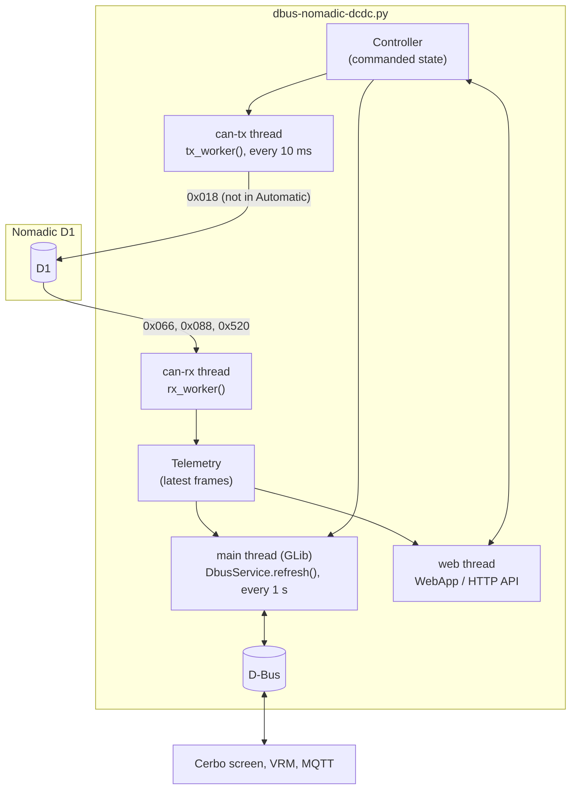

# Developer guide

How the driver is built, why it's built that way, and how to change it safely. For installing and using it,
see the [project README](../README.md). For every setting and D-Bus path, see the
[driver reference](../dbus-nomadic-dcdc/README.md).

---

## Contents

- [Big picture](#big-picture)
- [Files](#files)
- [Threads and data flow](#threads-and-data-flow)
- [The CAN messages](#the-can-messages)
- [Control logic](#control-logic)
- [What appears on the Cerbo and in VRM (D-Bus)](#what-appears-on-the-cerbo-and-in-vrm-d-bus)
- [The web page and its API](#the-web-page-and-its-api)
- [Simulation](#simulation)
- [Finding the converter (scan)](#finding-the-converter-scan)
- [Installation on the Cerbo](#installation-on-the-cerbo)
- [Tests](#tests)
- [Making a change](#making-a-change)
- [Open questions and ideas](#open-questions-and-ideas)

---

## Big picture

The driver is one Python program, [`dbus-nomadic-dcdc.py`](../dbus-nomadic-dcdc/dbus-nomadic-dcdc.py), that runs
as a service on a Victron GX device (Venus OS, which is Linux). It:

1. **Reads** the D1's CAN messages from a SocketCAN interface (`can0` / `can1` on a Cerbo GX).
2. **Publishes** the decoded values on D-Bus, where the Cerbo's GUI, VRM, MQTT and Node-RED pick them up.
3. **Sends** a control message every 10 ms, but only when the user has chosen Off, Buck or Boost.
   In Automatic it sends nothing.
4. **Serves** a small web page with a JSON API.

It uses only the Python standard library, plus what every GX device already has: `dbus-python`, `PyGObject`
(GLib) and Victron's [`velib_python`](https://github.com/victronenergy/velib_python). Nothing needs installing.



## Files

| File | What it contains |
|---|---|
| [`dbus-nomadic-dcdc.py`](../dbus-nomadic-dcdc/dbus-nomadic-dcdc.py) | Everything else: configuration, `Controller`, `Telemetry`, `CanBus`, `SimulatedD1`, `DbusService`, `WebApp`, `--scan`, `--monitor`, `main()` |
| [`nomadic_can.py`](../dbus-nomadic-dcdc/nomadic_can.py) | Pure-Python encoder/decoder for the four CAN messages, plus the alarm and mode texts. No dependencies |
| [`config.ini`](../dbus-nomadic-dcdc/config.ini) | Settings and safety limits, with comments |
| [`webui.html`](../dbus-nomadic-dcdc/webui.html) | The web page: one self-contained HTML file that polls `/api/status` |
| [`install.sh`](../dbus-nomadic-dcdc/install.sh) / [`uninstall.sh`](../dbus-nomadic-dcdc/uninstall.sh) | Register / remove the daemontools service |
| [`service/run`](../dbus-nomadic-dcdc/service/run), [`service/log/run`](../dbus-nomadic-dcdc/service/log/run) | daemontools start scripts (the program and its logger) |
| [`Cerbo Setup.bat`](../Cerbo%20Setup.bat) | Windows menu that copies the driver folder over SSH and runs the commands |
| [`tests/`](../tests) | Automated tests that run on any PC |

The whole `dbus-nomadic-dcdc/` folder is what gets copied onto the Cerbo (to `/data/dbus-nomadic-dcdc`), so it
must stay self-contained. That's also why the tests live outside it.

## Threads and data flow

| Thread | Function | What it does |
|---|---|---|
| `can-rx` | `rx_worker()` | Blocks on the CAN socket (0.5 s timeout) and feeds each frame to `Telemetry.feed()` |
| `can-tx` | `tx_worker()` | Every 10 ms asks `Controller.frame()` for a payload and sends it. `None` (Automatic) means send nothing |
| `web` | `ThreadingHTTPServer.serve_forever()` | The web page and API, one short-lived thread per request |
| main | `GLib.MainLoop` | Every `update_interval` (1 s): `StatusWatcher` (logs online/offline and alarm changes) and `DbusService.refresh()`. D-Bus write callbacks also run here |

- `Controller` and `Telemetry` each hold a lock. All other state is local to one thread.
- **Only the main thread touches D-Bus.** Changes made from the web page reach D-Bus at the next refresh.
- If a worker thread hits an unexpected error, `start_thread()` logs it and exits the process with
  `os._exit(1)`, so the service supervisor restarts the driver cleanly a second later.
- Expected transient CAN errors (`ENOBUFS`, `EAGAIN`, `ENETDOWN`: typically nothing acknowledging on the bus)
  are counted and logged at most every 30 seconds instead.

## The CAN messages

The D1's CAN interface is defined in Nomadic's *DC-DC Converter CAN Interface Control Document*
(NI-TLN-CONTROLS-DCDCCAN-R1). It isn't included here because it's Nomadic's copyrighted document; ask Nomadic for it.
All messages use 11-bit IDs and 8 data bytes, and the bus runs at 250 or 500 kbit/s.

| ID | Name | Direction | Period | Contents |
|---|---|---|---|---|
| `0x018` | EMS_DCDC_CTRL | Cerbo → D1 | 10 ms | Direction request (none / buck / boost), precharge request, current limit, voltage set-point, precharge voltage |
| `0x066` | DCDC_PARAMETER | D1 → Cerbo | 50 ms | Load, fault and voltage status bits, fault bits, operating mode, precharge status |
| `0x088` | DCDC_ELECTRIC_VALUE | D1 → Cerbo | 10 ms | 12 V side voltage and current, 48 V side voltage and current, board temperature |
| `0x520` | DCDC_VERSION | D1 → Cerbo | 100 ms | Software version (BCD) and hardware version |

**Bit layout.** Signals are Motorola (big-endian), and the "start bit" in the spec is the signal's most
significant bit, in the usual DBC numbering (`byte * 8 + bit`, bit 7 = MSB of the byte). This was confirmed by
`DCDC_ELECTRIC_VALUE`: under this convention its signals pack back-to-back with no gaps or overlaps. All bit
positions, scales and offsets are in [`nomadic_can.py`](../dbus-nomadic-dcdc/nomadic_can.py), and
[`tests/test_codec.py`](../tests/test_codec.py) checks them against frames worked out by hand.

**Details worth knowing:**

- Voltages are sent in 15 mV steps (factor 0.015), so 13.5 V goes out as 13.500 V and 13.4 V as 13.395 V.
  `0xFFF` is the error value, so the maximum is 61.41 V.
- The current limit is 0–254 A (`0xFF` is the error value). It applies to whichever side is the **output**.
  That's why the driver keeps separate buck and boost limits.
- Unused bits in `0x018` are sent as 0.
- Two places in the spec don't add up: the fault-status error value is given as `0x08` (which doesn't fit in
  3 bits), and the software version range is 24 bits wide while the field is 12 bits. The driver decodes the
  version as three BCD digits.

## Control logic

All in `class Controller`.

| `direction` | Meaning | What `frame()` returns |
|---|---|---|
| `-1` | **Automatic**: the D1 runs on its own logic | `None`: nothing is sent |
| `0` | Off | A frame with direction 0 |
| `1` | Buck (48 → 12 V) | Direction 1, `buck_voltage`, `buck_current_limit` |
| `2` | Boost (12 → 48 V) | Direction 2, `boost_voltage`, `boost_current_limit` |

Rules, in the order `frame()` applies them:

1. **Automatic sends nothing.** This is the default after every start (`startup = auto`), so installing the
   driver doesn't change how the D1 behaves.
2. **Test timer.** If `test_timer` is set and Buck or Boost has been running for longer than that, the
   direction becomes Off (logged, and saved).
3. **No direct reversal.** Changing between buck and boost sends Off for `direction_change_delay` seconds
   first, even when the change goes through Automatic in between.
4. **The set-point and current limit follow the side.** For Off, the values of the last active direction are
   sent.

Every change goes through `Controller.update()`. It validates **all** the values before changing **any** of
them, checks them against the limits from `config.ini`, raises `ValueError` with a readable message if
something's wrong, and saves the result to `state.json` (written atomically). The precharge request is never
restored after a restart.

## What appears on the Cerbo and in VRM (D-Bus)

`class DbusService` publishes the service `com.victronenergy.dcdc.nomadic_<interface>` with three groups of paths:

1. **Standard DC-DC converter paths** (`/Dc/0/*` for the 12 V side, `/Dc/In/*` for the 48 V side, `/State`,
   `/Mode`, `/FirmwareVersion` and so on), so it shows up in the GX device list like any converter.
2. **Its own paths** under `/Nomadic/*`: raw status bitfields, alarm texts and writable controls. These are for
   MQTT and Node-RED.
3. **Switch-pane items**, using Victron's [switch API](https://github.com/victronenergy/venus/wiki/dbus#switch):
   - `/GenericInput/<item>` holds the **read-only values**: alarm, status, voltages, currents, temperature and
     precharge status.
   - `/SwitchableOutput/<item>` holds the **controls**: the direction dropdown, number boxes for the set-points
     and limits, and the precharge toggle.

   Since Venus OS v3.80, the Cerbo's GUI, the VRM portal and the VRM app all show these automatically.

**Rules from Victron's GUI source** (`gui-v2`) that decide whether an item is shown at all. The tests check every
item against them:

- `/Name` must not be empty.
- `/Settings/Type` must be valid and have its bit set in `/Settings/ValidTypes`.
- An output needs a valid `/State` or `/Dimming`.
- Items sort alphabetically by name. A named group (`/Settings/Group`) gets its own card. On a named card, the
  GUI prefixes the device name unless `/Settings/CustomName` is set, so the driver sets it.

**Other mapping details:**

- The direction dropdown's index is `direction + 1`: index 0 is Automatic.
- Precharge items start hidden (`ShowUIControl` / `ShowUIInput` = 0), because the D1 manual doesn't use precharge.
- Names, groups and visibility that the user changes on the GX are saved in `ui.json`.
- Writes from the GX, VRM or MQTT go through the same `Controller.update()` checks. A refused value returns an
  error to the writer, and the GUI snaps back.

## The web page and its API

`class WebApp` serves [`webui.html`](../dbus-nomadic-dcdc/webui.html) and two endpoints:

| Request | Answer |
|---|---|
| `GET /` | The page |
| `GET /api/status` | JSON: `online`, `electric`, `parameter`, `alarms`, `version`, `control` (including `limits` and `test_timer_left`), `rx_age`, `tx` |
| `POST /api/control` | JSON body with any of `direction`, `buck_voltage`, `boost_voltage`, `buck_current_limit`, `boost_current_limit`, `precharge`, `precharge_voltage`. Returns the new status, or `400` with an error message |

- With `password` set in `config.ini`, every request needs HTTP Basic authentication (any user name).
- `POST` requires `Content-Type: application/json`. A browser has to ask permission before sending that to
  another site, and this server never grants it, so other web pages can't send commands through a visitor's browser.
- Bodies are limited to 4 KB.

## Simulation

`--simulate` swaps `CanBus` for `class SimulatedD1`, which has the same `recv()` / `send()` / `close()`
methods. Nothing touches a CAN socket. The pretend D1:

- Sends the three status messages at their real rates.
- Follows the manual's automatic logic: buck below 12.5 V (while the 48 V side is 41–58 V), up to about 13.4 V,
  with standby between 12.5 and 13.5 V.
- Obeys Off / Buck / Boost while control frames keep arriving. Boost stops below 12.3 V on the 12 V side.
- Flags "CAN loss" for 10 s if control frames stop, then goes back to automatic. This is an assumption, which is
  exactly what the hand-back test on real hardware will check.

`simulation_config()` gives the simulated device its own D-Bus name (`…nomadic_sim`), device instance (+1),
display name ("… (SIMULATED)"), web port (+1, so 8089) and state files. That way it can run next to a real
installation. Add `--no-dbus` to run it on any PC.

## Finding the converter (scan)

`--scan` (Cerbo Setup option 2) never transmits. For every interface in `/sys/class/net` of type 280 (CAN), it:

1. Reads the bitrate and CAN state with `ip -details -json link show`.
2. Listens for 3 seconds with the normal receive filter.
3. Compares the interface's `rx_errors` counter before and after.

Frames received means the D1 was found. No frames, but 10 or more new receive errors, means something is talking
at a **different bitrate**, so the scan tells the user to switch the port's speed. It also warns when Venus OS
is older than v3.80.

## Installation on the Cerbo

- **Files** live in `/data/dbus-nomadic-dcdc`. Everything under `/data` survives firmware updates.
- **`install.sh`** makes the files executable, links `service/` into `/service/dbus-nomadic-dcdc` (daemontools
  starts it within seconds and restarts it if it stops), and adds itself to `/data/rc.local`, so the link is
  re-created after every boot and firmware update.
- **Logs** go to `/var/log/dbus-nomadic-dcdc/current`, via `multilog`.
- **[`Cerbo Setup.bat`](../Cerbo%20Setup.bat)** sends the folder with `tar | ssh` (one password prompt), then
  tightens the file permissions on the Cerbo, because Windows `tar` marks files as writable by everyone.
- **Root access and SSH** must be switched on in the Cerbo's menus first (see the Installation Guide).

## Tests

```bash
python -m unittest discover -s tests -v
```

They run on Windows, macOS and Linux, need nothing but Python 3, and finish in a few seconds. A stand-in for
Victron's `vedbus` ([`tests/fakes/vedbus.py`](../tests/fakes/vedbus.py)) lets the D-Bus code run without Linux.
GitHub runs them on every push (see [`.github/workflows/tests.yml`](../.github/workflows/tests.yml)).
[tests/README.md](../tests/README.md) lists what each file covers.

## Making a change

1. **Keep the driver folder self-contained,** using only the standard library and what's on a GX device.
   Write Python 3.7-compatible code (no `match`, no `X | Y` type hints). Venus OS versions differ.
2. **Keep Unix line endings** (LF) for everything except `.bat` files. [`.gitattributes`](../.gitattributes)
   enforces this, because shell scripts with Windows line endings won't run on the Cerbo.
3. **Never put a file called `vedbus.py` in the driver folder.** It would replace Victron's library on the device.
4. **Try it:** `python dbus-nomadic-dcdc/dbus-nomadic-dcdc.py --simulate --no-dbus`, then open <http://localhost:8089>.
5. **Run the tests,** and add one for any new behaviour.
6. **Update the docs:** the [driver reference](../dbus-nomadic-dcdc/README.md) for settings and paths, this guide
   for design changes, and [CHANGELOG.md](../CHANGELOG.md). Bump `VERSION` in the driver.
7. **On a real system,** follow the [Safe Test Plan](safe-test-plan.pdf).

## Open questions and ideas

Waiting on real hardware or on Nomadic:

- **What the D1 does when control frames stop:** does it go back to automatic, and after how long? This decides
  whether "Automatic" can safely mean "send nothing" in every situation.
- **Whether the D1 sends its status without receiving commands.** The scan and monitor assume it does.
- **Current sign convention,** and whether the buck target may exceed 13.5 V over CAN.

Possible improvements:

- Raise GX notifications (alarms) for D1 faults, through Venus OS's alarm paths.
- Log the D1's own values to VRM for history graphs.
- Once the CAN-loss behaviour is known, decide how Automatic should hand control back after a restart.
